# Architecture — Post-Visit Summary & Clinical Coding Agent

This document explains how the system is put together: the top-level
components, the LangGraph agent topology, the database schema, and the
end-to-end request flows. All diagrams are Mermaid blocks that GitHub
renders natively.

- [1. System overview](#1-system-overview)
- [2. Component responsibilities](#2-component-responsibilities)
- [3. Agent graph (LangGraph)](#3-agent-graph-langgraph)
- [4. Data model](#4-data-model)
- [5. End-to-end flows](#5-end-to-end-flows)
- [6. State lifecycle and snapshots](#6-state-lifecycle-and-snapshots)
- [7. Guardrails and sign-off rules](#7-guardrails-and-sign-off-rules)
- [8. Observability / audit log](#8-observability--audit-log)

---

## 1. System overview

Three processes that talk over HTTP plus a Server-Sent Events (SSE)
channel for live agent progress.

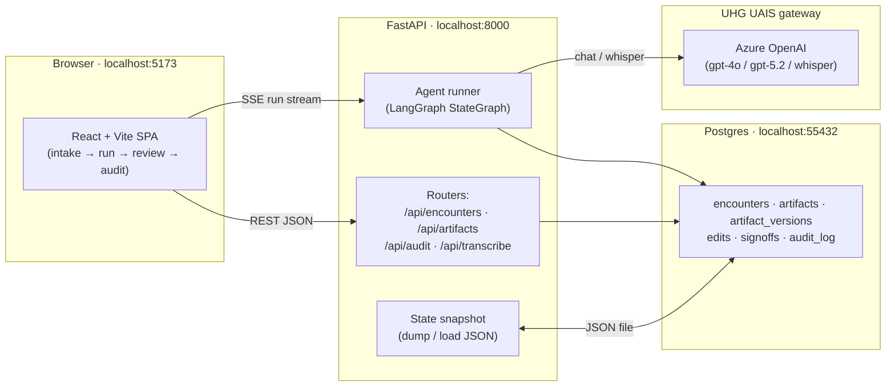

- The UI is a single-page React app; routes map 1:1 to FastAPI
  endpoints (see §5 for the per-flow sequence).
- The backend owns all business logic; the browser is a thin renderer.
- LLM calls are proxied through **UAIS** using an OAuth2
  client-credentials bearer token as the Azure `azure_ad_token`.
- Postgres is the single source of truth. A portable JSON snapshot
  auto-loads on first startup so a fresh clone bootstraps with the
  team's working data set (see §6).

---

## 2. Component responsibilities

### Frontend (`@/web`)

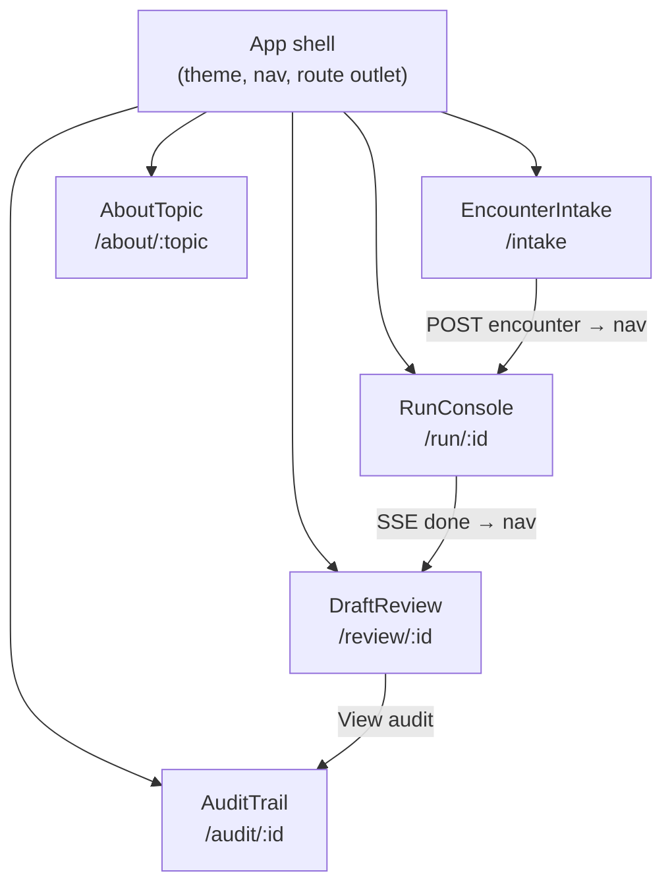

| Route             | Page                | Key behaviour                                                             |
|-------------------|---------------------|---------------------------------------------------------------------------|
| `/intake`         | `EncounterIntake`   | Seeded encounters · upload audio · paste transcript · "Drafts / Signed"  |
| `/run/:id`        | `RunConsole`        | Live SSE timeline of the 7-node agent graph                               |
| `/review/:id`     | `DraftReview`       | Per-artifact tabs (SOAP, PCP, Problems, Coding, Gaps) with sign-off       |
| `/audit/:id`      | `AuditTrail`        | Chronological audit log for an encounter                                  |
| `/about/:topic`   | `AboutTopic`        | Explainer cards for `agents`, `artifacts`, `guardrails`                   |

### Backend (`@/backend/app`)

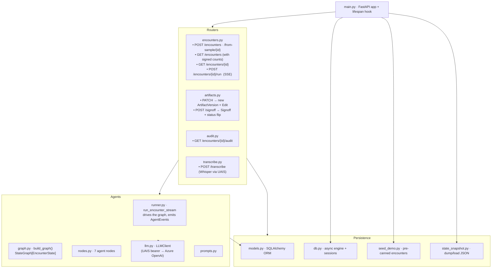

---

## 3. Agent graph (LangGraph)

The run is a single `StateGraph[EncounterState]` compiled once at
process start (cached) and driven per encounter. Fan-out after
`structurer`, join at `guardrail`.

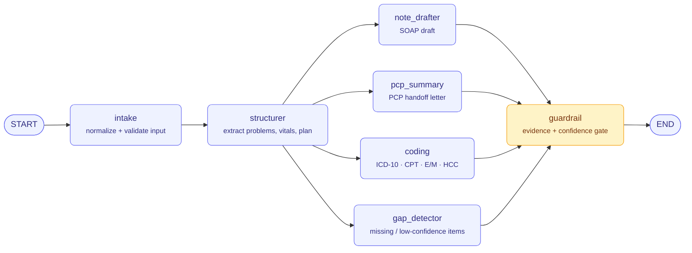

Each node reads from and writes into a shared `EncounterState`
TypedDict (`backend/app/agents/state.py`). Every node also emits
`node_started` / `node_completed` events into a queue that the FastAPI
SSE endpoint streams back to the browser.

### State envelope

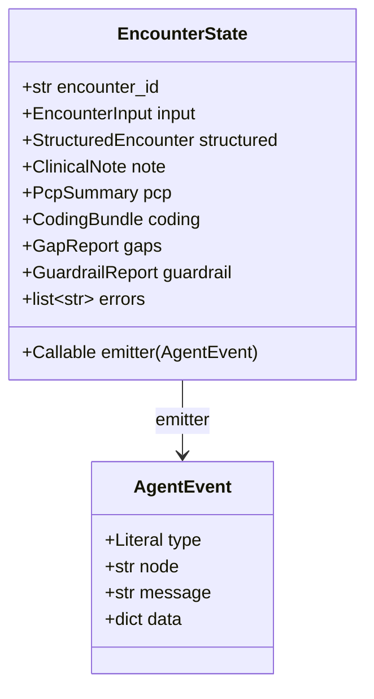

### Node contracts (brief)

| Node            | Reads                     | Writes                   | Notes                                   |
|-----------------|---------------------------|--------------------------|-----------------------------------------|
| `intake`        | `input`                   | validated `input`        | no LLM                                  |
| `structurer`    | `input`                   | `structured`             | LLM call, extracts problems + plan      |
| `note_drafter`  | `structured`              | `note`                   | LLM call, SOAP                          |
| `pcp_summary`   | `structured`              | `pcp`                    | LLM call, PCP letter                    |
| `coding`        | `structured` + `note`     | `coding`                 | LLM call, uses 650+ ICD-10-CM / 385+ CPT / 271 HCC V28 reference codes |
| `gap_detector`  | all prior                 | `gaps`                   | LLM + rule pass, flags missing items    |
| `guardrail`     | all prior                 | `guardrail`              | Demotes no-evidence items, sets review  |

### Reference code databases

The `coding` node is backed by comprehensive clinical code databases
loaded from `backend/app/data/`:

| File               | Contents                            | Count    |
|--------------------|-------------------------------------|----------|
| `icd10_seed.json`  | ICD-10-CM 2025 diagnosis codes      | 650+     |
| `cpt_seed.json`    | CPT / HCPCS Level II procedure codes| 385+     |
| `hcc_map.json`     | CMS-HCC V28 risk-adjustment map     | 271      |

**ICD-10-CM** covers all major chapters: infectious (A/B), neoplasms (C/D),
blood (D50–D89), endocrine/diabetes (E), mental health (F), nervous system (G),
eye/ear (H), circulatory (I), respiratory (J), digestive (K), skin (L),
musculoskeletal (M), genitourinary (N), pregnancy (O), symptoms (R),
injury (S/T), external causes (W), and Z-codes.

**CPT/HCPCS** spans E&M (office, hospital, ED, critical care, nursing facility,
home, telehealth, care management, preventive/wellness), surgery (all
subspecialties), radiology/imaging, 68+ laboratory codes, medicine
(cardiology, pulmonary, allergy, neurology, physical medicine), infusions,
immunizations, vaccines, and HCPCS Level II (G/J codes).

**HCC V28** maps 271 ICD-10 codes to 47 distinct HCC risk-adjustment
categories. The full map is injected into the coding prompt for accurate
risk-adjustment capture.

`reference.py` builds a token-efficient prompt (~5,200 tokens) that
includes the complete HCC map and E&M codes, with a note that the LLM
may use any valid ICD-10-CM, CPT, or HCPCS code — not just the reference set.

---

## 4. Data model

Six tables, all keyed by UUIDs. An encounter fans out to five
artifacts (one per `kind`); each artifact has an append-only version
history. The first signoff row per artifact freezes it.

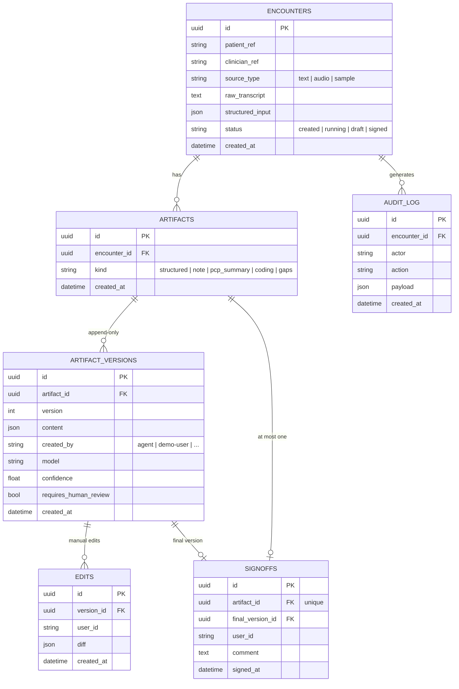

Key invariants enforced in code:

- **One signoff per artifact.** `signoffs.artifact_id` is unique; the
  PATCH endpoint refuses to mutate signed artifacts.
- **Encounter status is derived.** `encounter.status` flips to
  `signed` only when every artifact on it has a signoff (enforced both
  per-signoff and via a startup backfill).
- **Every mutation is audited.** Create, run, edit, signoff, and
  override all insert an `audit_log` row.

---

## 5. End-to-end flows

### 5.1 Create encounter + run agents

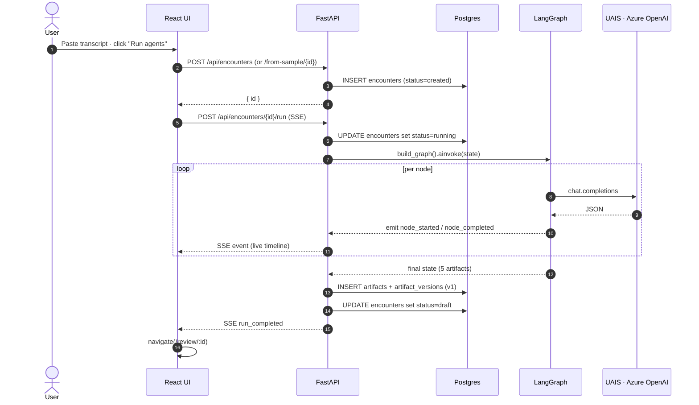

### 5.2 Review, edit, sign off an artifact

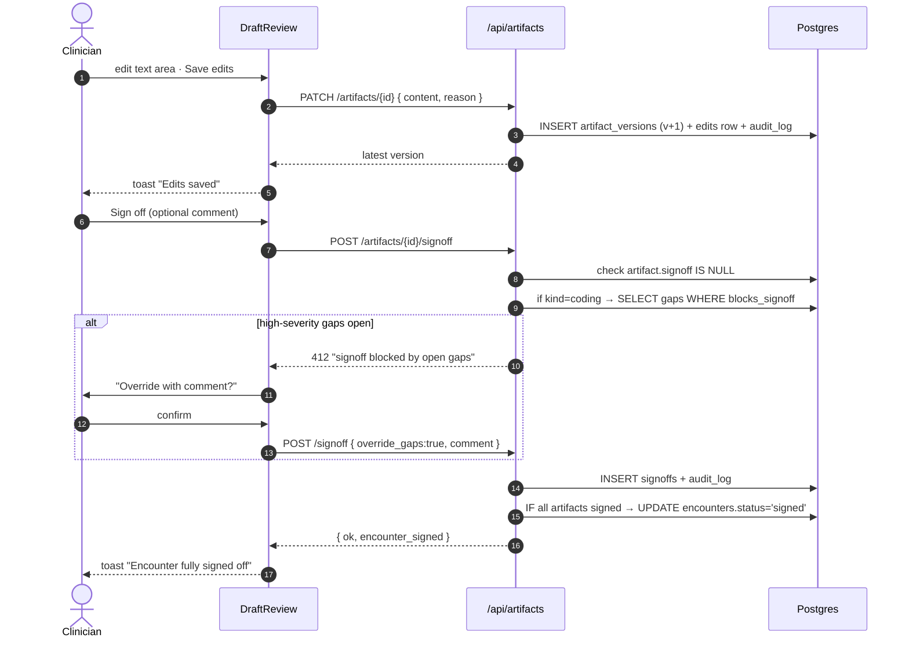

### 5.3 Home page listing — derived "Signed off" bucket

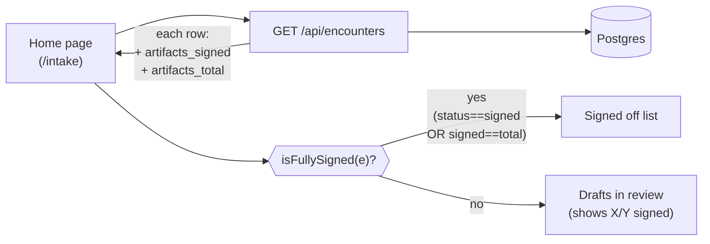

The frontend treats an encounter as signed off when **either** its
stored status is `signed` **or** `artifacts_signed === artifacts_total`.
That keeps the UI correct even before the status-flip code has had a
chance to run against older rows.

---

## 6. State lifecycle and snapshots

Snapshots make the DB state portable so a fresh clone gets the same
working data the team has locally.

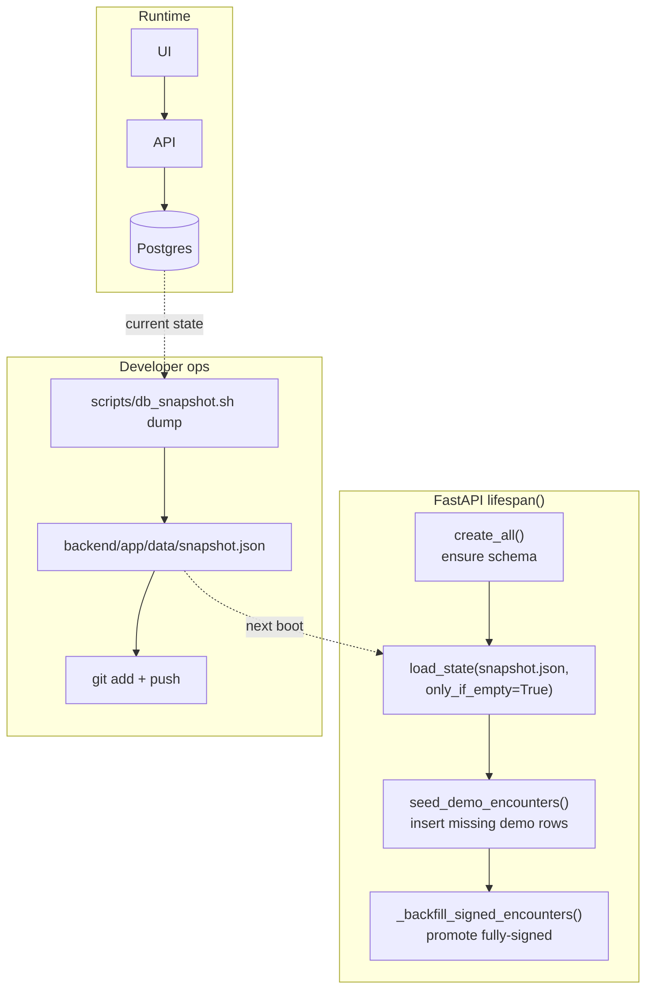

- `load_state` is a **no-op** when the `encounters` table already has
  rows, so it's safe to call on every startup.
- Snapshots preserve UUIDs, timestamps, version numbers, edit history
  and signoffs. Everything round-trips.

---

## 7. Guardrails and sign-off rules

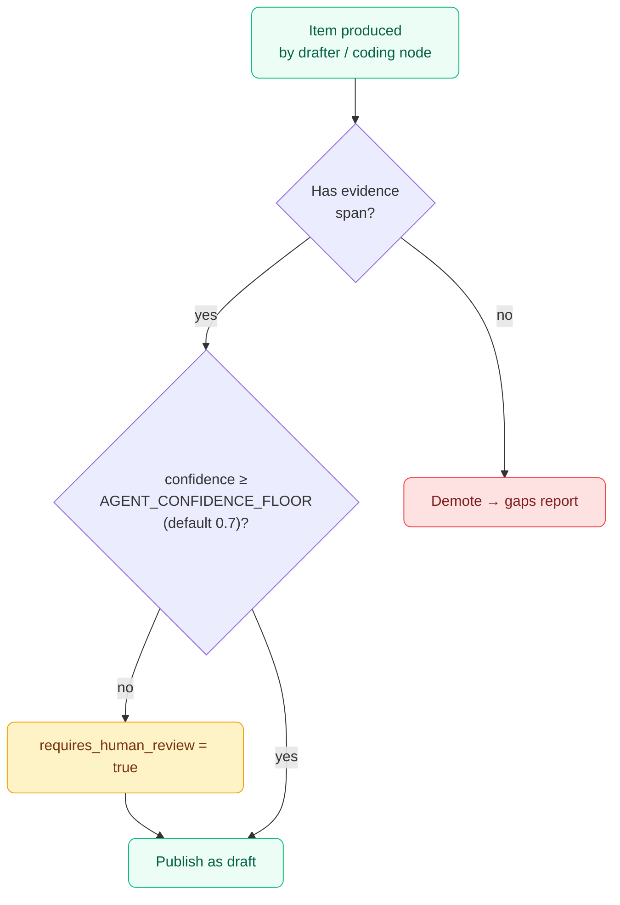

Runtime rules applied at sign-off time:

1. **Coding signoff** reads the latest `gaps` artifact. If any gap has
   `blocks_signoff=true` and `override_gaps` was not passed, the API
   returns HTTP 412 with the list of blockers.
2. The clinician can override with a comment — the signoff still
   records `override_gaps=true` in the audit payload.
3. Sign-off cannot replace a sign-off (unique constraint on
   `signoffs.artifact_id`).

---

## 8. Observability / audit log

Every mutating action produces an `audit_log` row. The frontend
`AuditTrail` page calls `GET /api/encounters/{id}/audit` to render a
chronological view.

| `action`                   | Emitted by                   | Payload highlights                              |
|----------------------------|------------------------------|-------------------------------------------------|
| `encounter_created`        | `POST /encounters`           | `source_type`, optional `sample_id`             |
| `run_started`              | Agent runner                 | —                                               |
| `run_completed`            | Agent runner                 | `requires_human_review`, `model`, dropped items |
| `artifact_edited`          | `PATCH /artifacts/{id}`      | `kind`, `version`, `reason`                     |
| `artifact_signed`          | `POST /artifacts/.../signoff`| `kind`, `version`, `override_gaps`, `comment`   |
| `encounter_signed`         | artifacts router + backfill  | `final_artifact_id`, `source` (if backfill)     |
| `demo_encounter_seeded`    | `seed_demo.py`               | `sample_id`                                     |

Combined with `artifact_versions` (append-only content) and `edits`
(diff + user), the audit trail is sufficient to reconstruct the exact
state of any artifact at any moment — the legal basis for "clinician
signed off on version N at time T".

---

## Further reading

- `@/LOCAL_SETUP.md` — copy-pasteable setup instructions for a fresh machine.
- `@/backend/app/agents/` — each node, prompts, and state types.
- `@/backend/app/state_snapshot.py` — dump/load implementation.
- `@/web/src/pages/RunConsole.tsx` — SVG flowchart component driven by SSE.
