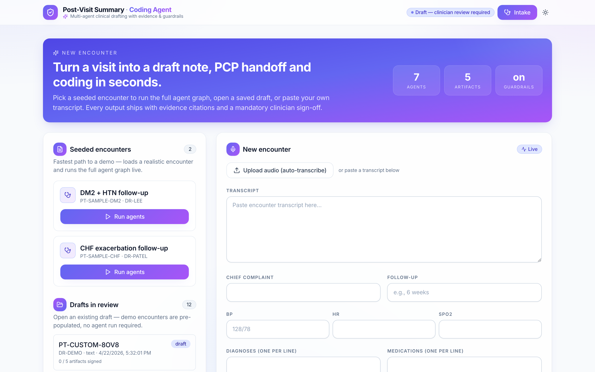
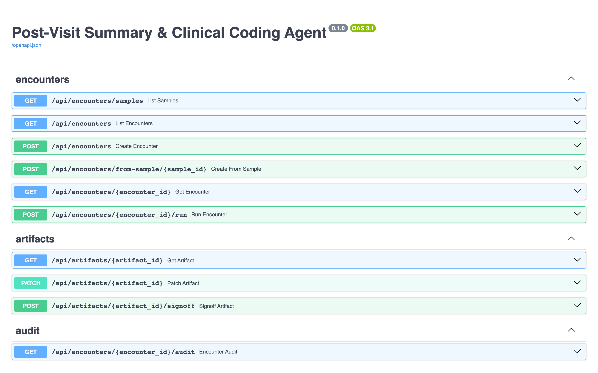
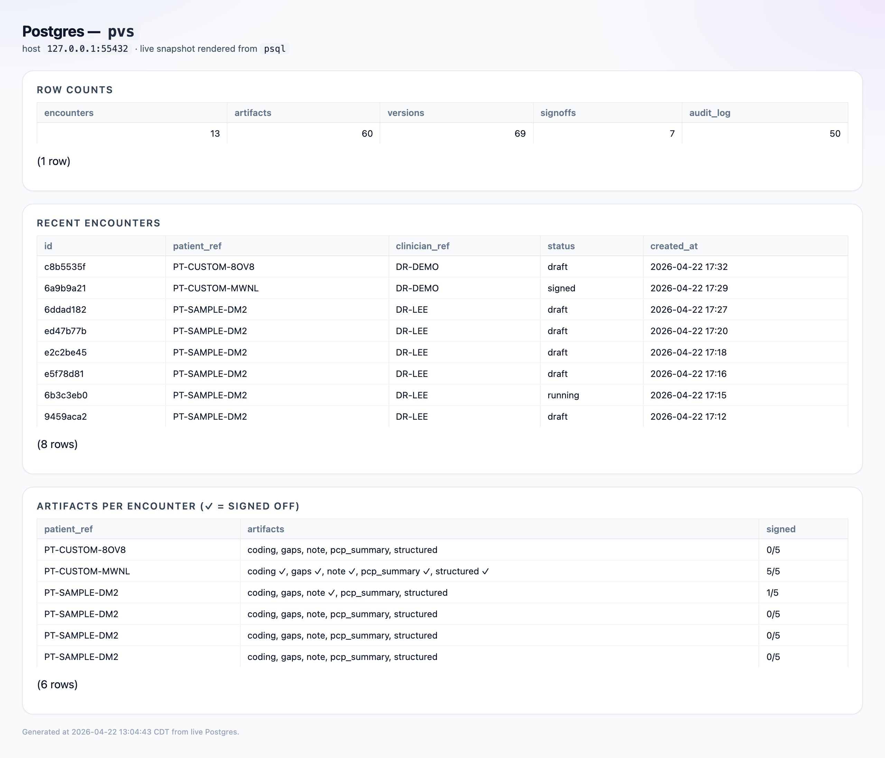

# Post-Visit Summary & Clinical Coding Agent

Multi-agent system that turns an encounter (audio or text + structured fields) into a clinical note draft, a PCP handoff summary, and coding artifacts (ICD-10, CPT, E/M, HCC) — all persisted as drafts with a full audit trail until a clinician signs off.

> **Running it locally?** See [`LOCAL_SETUP.md`](./LOCAL_SETUP.md) for a copy-pasteable end-to-end walkthrough (Postgres via Podman, backend venv, frontend dev server, snapshot load, smoke test, troubleshooting).
>
> **Curious how it's built?** See [`ARCHITECTURE.md`](./ARCHITECTURE.md) for the system diagram, LangGraph agent topology, data model ERD, and sequence diagrams for the create/run/review/signoff flows.

## Screenshots

### Frontend — home page (`http://localhost:5173`)

Seeded encounters, a "Drafts in review" list with per-artifact sign-off progress,
and a separate "Signed off" bucket. Upload audio or paste a transcript and hit
**Run agents** to drive the full LangGraph pipeline.



### Backend — interactive API docs (`http://localhost:8000/docs`)

FastAPI auto-generated OpenAPI docs for all endpoints: encounters, artifacts
(patch / signoff), audit trail, transcription.



### Database — live Postgres state

Rendered from `psql` against the running Postgres container. Shows row counts,
recent encounters, and per-encounter artifact sign-off progress
(✓ = artifact signed off).



Regenerate these at any time (requires the stack to be running):

```bash
cd scripts/screenshots
npm install                     # first time only
npx playwright install chromium # first time only
./build_db_html.sh              # refresh the DB HTML preview
node capture.js                 # re-shoot all three PNGs into docs/screenshots/
```

See `scripts/screenshots/README.md` for details.

## Stack

- **Backend**: FastAPI, LangGraph, Azure OpenAI via UHG **UAIS** (OAuth2 client-credentials → bearer token used as `azure_ad_token`, with `projectId` header), SQLAlchemy (async), Postgres
- **Frontend**: Vite + React + TypeScript + TailwindCSS + shadcn-style components
- **Streaming**: Server-Sent Events for live agent progress

## Quick start (Podman)

```bash
cp .env.example .env
# edit .env and fill in UAIS_* / HCP_* values (see `references/` for the schema)

# First-time Podman setup on macOS (skip if already done):
podman machine init
podman machine start

# Bring the stack up (pick whichever of these is installed):
podman compose up --build            # Podman v4.4+ built-in compose
# or
podman-compose up --build            # the separate `podman-compose` tool
```

- Web UI: http://localhost:5173
- API docs: http://localhost:8000/docs

Common Podman commands:

```bash
podman compose ps                    # show containers
podman compose logs -f api           # tail API logs
podman compose exec api pytest -q    # run the smoke test
podman compose down                  # stop
podman compose down -v               # stop and drop the postgres volume
```

On first boot the API creates all tables via SQLAlchemy metadata and exposes the two sample encounters through `GET /api/encounters/samples`.

> The `docker-compose.yml` is standard Compose v3 syntax and works unchanged with Podman. If you prefer Docker, `docker compose up --build` still works.

## Demo flow

1. Open the web UI, pick a seeded sample (e.g., "CHF follow-up").
2. Click **Run agents** — watch the SSE timeline (structurer → note ∥ pcp ∥ coding ∥ gaps → guardrail).
3. Review drafts across tabs (Note, PCP Summary, Problems, Orders, Referrals, Coding, Gaps).
4. Edit a suggested ICD-10 code; a new version + audit entry is recorded.
5. Try to sign off while a required gap is open — blocked. Resolve or override with comment, then sign off. Final view + full audit trail.

## Guardrails

- All artifacts are drafts until a `signoff` row exists.
- Every coding suggestion must cite evidence (transcript / structured-input span); items without evidence are demoted to gaps.
- Items below the confidence floor (default 0.7) are surfaced under "Needs review".
- Every LLM call, node transition, edit, and signoff is recorded in `audit_log`.

## Repo layout

See `backend/` and `web/` — or the plan doc at `../.windsurf/plans/post-visit-summary-agent-814de5.md`.

## Running without Docker

```bash
# Backend
cd backend
python -m venv .venv && source .venv/bin/activate
pip install -e .
export DATABASE_URL=sqlite+aiosqlite:///./pvs.db   # SQLite fallback
uvicorn app.main:app --reload

# Frontend
cd web
npm install
npm run dev
```
